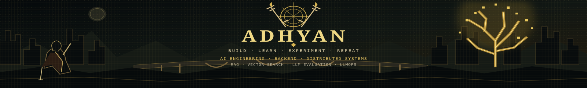

<!-- Custom banner -->
<p align="center">
  
</p>

<p align="center">
  <a href="https://adhyan-25.github.io/portfolio/"></a>
  <a href="https://github.com/Adhyan-25"></a>
  <a href="mailto:adhyannegi81@gmail.com"></a>
</p>

## `$` About me

I'm a B.Tech student focused on **backend engineering, distributed systems, and scalable APIs**. I like building systems, measuring their trade-offs, and documenting what works—and what doesn't.

- `>_` Interested in system design, reliability, caching, and performance
- `>_` Learning by building end-to-end projects
- `>_` Currently strengthening testing, CI/CD, and deployment practices

## `$` Tech stack

<p>
  
  
  
  
  
  
  
  
  
</p>

## `$` Featured projects

<table>
  <tr>
    <td width="50%" valign="top">
      <h3>🔎 <a href="https://github.com/Adhyan-25/smart-search-engine">Smart Search Engine</a></h3>
      <p>Backend-focused search and autocomplete platform exploring scalable architecture and data structures.</p>
      <p><strong>Inside:</strong> Trie autocomplete · LRU cache · Bloom filter · Redis token bucket · Consistent hashing · Nginx · BullMQ</p>
      <a href="https://github.com/Adhyan-25/smart-search-engine">Explore repository →</a>
    </td>
    <td width="50%" valign="top">
      <h3>₿ <a href="https://github.com/Adhyan-25/Autocryp">AutoCrypt</a></h3>
      <p>Bitcoin transaction-flow visualisation concept for tracing movement between addresses.</p>
      <p><strong>Stack:</strong> React · TypeScript · Vite · D3.js</p>
      <p><em>Release status: source entry point is currently missing; build is not yet passing.</em></p>
      <a href="https://github.com/Adhyan-25/Autocryp">Explore repository →</a>
    </td>
  </tr>
  <tr>
    <td colspan="2" valign="top">
      <h3>⌘ <a href="https://adhyan-25.github.io/portfolio/">Terminal-style Portfolio</a></h3>
      <p>A terminal-inspired personal site with a project explorer and resume support.</p>
      <a href="https://adhyan-25.github.io/portfolio/">Open live website →</a>
    </td>
  </tr>
</table>

## `$` Current focus

```text
[ learning ]  System design and backend architecture
[ building ]  Reliable APIs and distributed components
[ improving ] Testing, CI/CD, and performance measurement
```

<p align="center">
  <sub>Understand the system. Measure the trade-offs. Improve the design.</sub>
</p>
